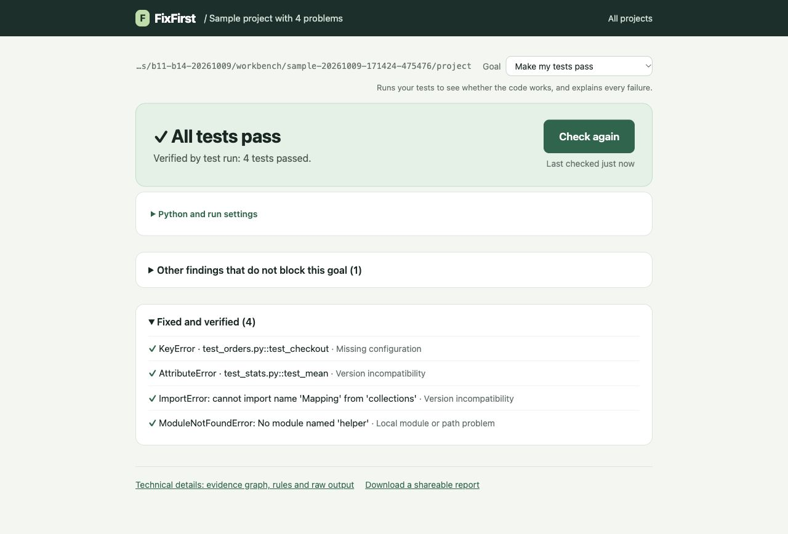

## SECTION 1 : PROJECT TITLE
## FixFirst: find why a Python project fails, what to fix first, and when it is really fixed



---

## SECTION 2 : EXECUTIVE SUMMARY / PAPER ABSTRACT

FixFirst helps a developer or a coding agent find out why a Python project does not run, what to fix first, and when
it is really fixed. It runs the project's own checks with the project's own interpreter, explains each failure with
its evidence, rule and official source, proposes one concrete next step, and closes an issue only after a real check
passes again. People use a local web page or the command line; coding agents use the same diagnosis through the Model
Context Protocol (MCP). FixFirst never edits code or installs anything into the project's environment.

The reasoning combines 132 forward-chaining production rules, a knowledge graph of 737 removal and 12 deprecation
entries from 191 sources, a session graph linking evidence, causes, actions and checks, a decision tree over 81
evidence features for cases that no rule settles, and grouping of repeated messages.

Through MCP, FixFirst raised the repair rate of the local model Gemma 4 26B-A4B from 38.9% to 90.0% on 18 sealed
tasks, and its own first check of those tasks gave all 29 failures a cause class of the reference repair (17 of 17 in
single-class tasks). With the failing tests named, it closed 27 of 28 unseen real code defects only after the real fix
and none wrongly. Six participants were 23.4% faster in median time with it, a trend (p = 0.094).

---

## SECTION 3 : CREDITS / PROJECT CONTRIBUTION

| Official Full Name | Student ID (MTech Applicable) | Work Items (Who Did What) | Email (Optional) |
| :--- | :---: | :--- | :--- |
| HE ZIHANG | A0xxxx72R | Built FixFirst with AI coding assistants: rules, knowledge graph, decision tree, message grouping, planning and verification, and the web, command-line and MCP interfaces. Froze the candidate versions and released 0.8.0. Ran the evaluations of diagnosis, the language-model baselines, the coding-agent experiment, the real BugsInPy defects, grouping and ordering. Wrote the report and the user guide; produced the videos. | |
| WEI YI | A0xxxx64H | Reviewed the labels of the real projects and rated first steps independently. Ran the participant study. Accepted 0.8.0rc5 on Windows 11 and prepared the corrections included in 0.8.0. Made the report template and the structure of the report and the videos; narrated the promotion video. | |
| CHI YONGJUN | A0xxxx66A | Owned the held-out evaluation of twelve real projects: sampling, environments, labels, the single run of v0.7.0, scoring and the published evidence. Fixed the held-out tool. Prepared and scored the language-model baseline on the real projects; narrated the system video. | |

Student IDs are masked in this public repository; the Canvas submission carries them in full.

---

## SECTION 4 : VIDEO OF SYSTEM MODELLING & USE CASE DEMO

- Promotion video: https://youtu.be/TeOLz7CjBAk
- System video: https://youtu.be/Ly8fGxLmB5A

Both are under five minutes and unlisted on YouTube. [Video/README.md](Video/README.md) lists the narrators, the
English subtitle files and the music licence.

---

## SECTION 5 : USER GUIDE

`Refer to appendix C, Installation and user guide, in the project report at Github Folder: ProjectReport`

Quick start, with Python 3.10 or later on macOS, Linux or Windows 10/11:

```bash
git clone https://github.com/ZihangHe13123/FixFirst.git
cd FixFirst/SystemCode
bash scripts/setup.sh python3.12
.venv/bin/fixfirst serve
```

On Windows, in PowerShell:

```powershell
git clone https://github.com/ZihangHe13123/FixFirst.git
cd FixFirst\SystemCode
powershell -ExecutionPolicy Bypass -File scripts\setup.ps1
.\.venv\Scripts\fixfirst.exe serve
```

The browser opens the local interface; choose **Open a sample project** to try it. The command line and the MCP
server for coding agents are described in [SystemCode/README.md](SystemCode/README.md). The release `v0.8.0` was tagged
before the code moved into `SystemCode/`; in a checkout of that tag the same commands run from the repository root.

---

## SECTION 6 : PROJECT REPORT / PAPER

`Refer to project report at Github Folder: ProjectReport`

The report covers:

1. Introduction
2. Problem Analysis and Requirements
3. Use Case Analysis
4. System Architecture and Design
5. Machine Learning and Reasoning Design
6. System Implementation
7. Evaluation and Results
8. Discussion and Limitations
9. Team Roles and Contributions

followed by the references, the AI assistance statement and four appendices: A Project proposal, B Mapping to the MR,
RS and CGS courses, C Installation and user guide, D Experiment details.

---

## SECTION 7 : MISCELLANEOUS

`Refer to Github Folder: Miscellaneous`

- [FixFirst-Proposal.pdf](Miscellaneous/FixFirst-Proposal.pdf): the project proposal as submitted
- [FixFirst-Proposal-Presentation.pdf](Miscellaneous/FixFirst-Proposal-Presentation.pdf): the slides of the proposal
  presentation
- [SystemCode/docs/user-study/](SystemCode/docs/user-study/): participant study protocol, consent form, questionnaire,
  task projects, anonymised data and analysis script
- [SystemCode/experiments/](SystemCode/experiments/) and [SystemCode/examples/](SystemCode/examples/): experiment code,
  records and results behind Chapter 7 of the report
