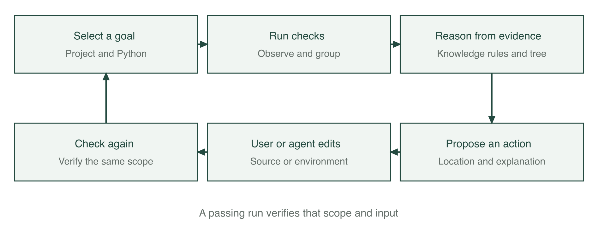
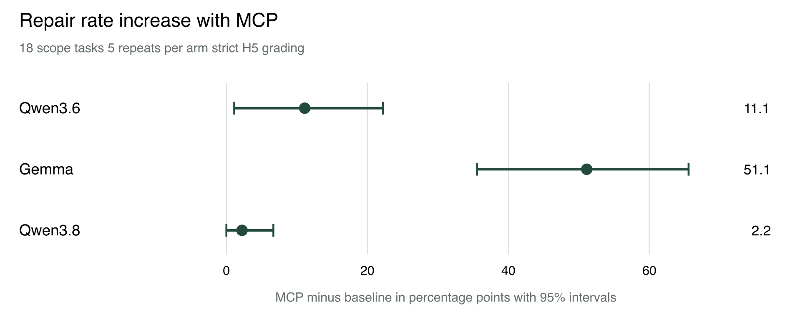

# FixFirst diagnosis and verified repair for Python projects

NUS ISS Intelligent Reasoning Systems Practice Module | Group 24

HE ZIHANG | WEI YI | CHI YONGJUN

Report version 0.8 | 14 October 2026

**DRAFT — INCOMPLETE — FOR TEAM DISCUSSION**

A working draft for group discussion. Evidence, interpretation and wording require review by all three members. This report is incomplete and is not ready for submission.

Still pending: independent installation and Windows acceptance, proposal attachment, individual reflections and final packaging.

Product status: 0.8.0rc5 remains the trial baseline. The final delivery version awaits teammate feedback. A small participant study was run on 12 and 13 October; Section 5.11 reports it.

Review agenda and remaining work: docs/report/TEAM-REVIEW.md.

## 1 Executive summary

FixFirst helps a developer or coding agent understand why a Python project cannot run and decide what to fix first. It collects evidence from the project's own interpreter and checks, relates failures to dependency and API knowledge, proposes an action, and verifies the next run. Its web interface and command line serve people; its Model Context Protocol interface supplies the same diagnostic process to coding agents. FixFirst does not edit source code or install repair dependencies into the project environment. The user or agent performs the proposed changes.

The implementation combines production rules, domain and session knowledge graphs, an evidence based decision tree, and message grouping. The agent experiment was run on the release candidate frozen for it, 0.8.0rc2; three further candidates followed, and the version described elsewhere in this report is 0.8.0rc5, with 132 rules and an 81 feature tree that did not change between them. The system focuses on dependencies, import paths, configuration and compatibility. A successful script execution establishes success for that entry and input; it does not establish business logic correctness.

The results show different benefits for different users and models. In the earlier twelve project evaluation of v0.7.0, four first steps were rated correct, one partial, six generic and one wrong. This exposed concrete gaps that informed subsequent development. In a separate experiment on 22 constructed tasks revealed after v0.8 was frozen, 660 paired agent runs were completed. On the 18 tasks within scope, MCP increased Gemma's strictly scored repair rate from 38.9% to 90.0%. Qwen3.6 and Qwen3.8 already solved most tasks; their clearest benefit was fewer turns, less time and fewer recorded tokens on tasks both groups could solve. These are results for the registered tasks and conditions, not a reliability estimate for arbitrary real projects.

A separate 132 run cloud comparison with DeepSeek V4.1 Flash was completed and independently recomputed. Both arms repaired all 54 scope runs, leaving no observed repair rate difference. Across the eighteen scope tasks, MCP to baseline ratios were 0.82 for turns, 0.71 for time and 0.72 for tokens. Savings were uneven across tasks, and code defect controls had additional overhead.

After the agent experiment the frozen product was run on real code defects from BugsInPy. It gave no required environment-changing command for any of 27 defects, but in 24 of them its own check never reached the failing test, because the project's tests could not be collected by a default pytest run. Three further candidates added the option to name the tests to check and removed limits found on the way. Each was tested once on defects it had not seen: with the tests named, the candidate tested saw the failure and closed the issue only after the repair in 9 of 19, 21 of 28 and 27 of 28 defects, and closed none wrongly. These three results come from different versions and material and are not a trend line. In default use on real repositories the same limits largely remain.

In a study with six participants, median repair time was 23.4% lower with FixFirst and five of six were faster. The difference was not statistically significant (p = 0.094).

## 2 Business case market research and literature review

### 2.1 The problem

A repository may be available while its execution environment is no longer reproducible. An import failure can mean a missing distribution, a local path problem, a removed standard library name or a library version mismatch. Installing a package named after the import is therefore not always a useful first action. A passing dependency metadata check also does not establish that the application can execute.

Mukherjee, Almanza and Rubio-González examined 2,702 historical Python builds. Their PyDFix study identified 1,921 builds with dependency related reproducibility failures and obtained complete fixes for 859 of them [1]. This is evidence of a maintenance problem in that study's build datasets, rather than an estimate of the failure rate of all Python projects.

Our early thirteen project investigation similarly found that following installation instructions often did not produce a runnable test suite. Those projects became development material after their failures were inspected. The later A2 evaluation and sealed B7 tasks are distinguished from this pilot in Section 5.

### 2.2 Users and value

The initial users are students running an unfamiliar assignment, developers taking over a legacy Python repository, maintainers helping a new contributor, and researchers reproducing code. They need an executable next step supported by evidence. An agent needs that information in a compact form it can act on, together with a way to check whether the change actually worked.

For a person, the proposed value is a shorter route from traceback to a concrete action, with an explanation that can be checked. For an agent, the measured value can be a higher repair rate or fewer unsuccessful investigation steps. The agent experiment measures these outcomes separately; a reduction in turns is not assumed to imply a reduction in elapsed time.

### 2.3 Existing tools

| Tool or approach | Main role | Relationship to FixFirst |
|---|---|---|
| pip check | Check compatibility of installed dependency metadata [4] | Supplies useful evidence; it does not run the project's program or tests |
| pipdeptree | Display installed package dependency relationships [5] | Helps inspect an environment; FixFirst connects those facts to observed failures |
| Dependabot | Propose configured dependency updates [6] | Useful for maintenance; FixFirst starts from the failure in the current environment |
| Renovate | Automate dependency update workflows [7] | Complementary to diagnosing and verifying a failed local run |
| tox | Execute checks in configured environments [8] | Reproduces checks; FixFirst explains collected evidence and prioritises actions |
| General coding agents | Inspect files, edit code and execute commands | FixFirst can provide diagnostic knowledge through MCP while the agent performs repairs |

The distinction is a workflow comparison. We do not claim that existing tools are unable to diagnose errors, or that FixFirst replaces a general coding agent.

### 2.4 Relevant research

PyDFix analyses dependency related build failures and searches for version changes that restore reproducibility [1]. FixFirst shares the use of actual failure evidence and subsequent verification. Its interactive advice also includes local modules and project configuration, and its repair changes are performed by a person or agent.

DockerizeMe infers dependencies for Python code snippets using package knowledge and graph based inference [2]. Its study motivates the mapping from imported modules to distributions. FixFirst additionally checks whether the import refers to the standard library or a local project file before suggesting installation.

BugsInPy supplies real Python bugs with test suites for controlled testing and debugging research [3]. The paper reports 493 bugs in 17 projects; our repository's index, taken at commit 11c5f1e of the BugsInPy repository, lists 501 bugs in the same 17 projects (the eight additional bugs are all in black), so these are not interchangeable denominators. It is useful for checking whether a diagnostic tool wrongly blames the environment for a code defect, but is not a balanced dataset of all five FixFirst cause classes.

These studies informed the design and evaluation sources. Their reported repair percentages are not directly comparable to our agent experiment because the tasks, interventions and success criteria differ.

### 2.5 Delivery and pricing

The submitted product is a free community implementation with local web, CLI and MCP interfaces. No paid account is required to use FixFirst's rules or classifier. A client that uses a commercial language model has its own provider charges; those are separate from FixFirst.

A possible later offer is paid maintenance and integration support, with team rule sharing or CI reporting. These are commercial hypotheses, not implemented subscriptions or validated willingness to pay. We have no customer survey from which to infer market size or revenue. The community edition and a working demonstration are the appropriate initial offer.

## 3 System design and model

### 3.1 The diagnostic loop

The user selects a project, its Python interpreter and a goal. FixFirst runs the relevant checks, groups related findings, derives evidence facts, queries domain knowledge, applies rules, orders actions and records the next verification. A later failure can become visible after an earlier collection error has been fixed. The plan is therefore recomputed after each check rather than treated as a complete list of repairs known in advance.

Figure 1. The developer or agent performs edits. FixFirst records checks, explanations and verification.

### 3.2 Evidence and root causes

The five cause classes are missing dependency, local module or import path, version incompatibility, missing configuration, and a defect in project code or tests. The last class is a diagnostic boundary: an assertion failure can require investigation of application logic that FixFirst does not attempt to repair.

Evidence includes the exception and its location, installed package metadata, static project declarations, import relationships, and the outcome of the selected program or tests. Where supported, runtime receiver identity distinguishes a real library object from a project class with the same name. Missing or over limit evidence causes the system to remain conservative.

Declarations are inspected statically; setup.py is not executed to discover requirements. A version pin, a lock file and a successful test run provide different kinds of evidence. A lock file records a chosen version, not proof that that version passes the project's tests.

### 3.3 Knowledge and rules

At frozen commit 5c224cf, the domain file contains 737 removal entries, 12 deprecation entries and 190 source records. The rule file contains 132 rules. These are entry counts, not counts of independent libraries, faults or semantically verified replacement programs. The receiver verification receipts and knowledge receipts describe what was executed; some replacement advice still lacks a dedicated semantic probe.

These counts describe the agent experiment version. At the rc5 freeze, the rule file still has 132 rules, and the domain file still has 737 removal and 12 deprecation entries. Its source records increase from 190 to 191, and its behaviour entries from 10 to 12.

The production engine uses five phases: derive facts, diagnose, apply heuristics, consider a classifier fallback, and construct a plan. Rules retain their supporting facts and provenance. For example, a Python 3.12 import of collections.Mapping can be related to the removal documented for Python 3.10. The proposed source edit is to import Mapping from collections.abc. The issue is closed only after a relevant completed check succeeds.

The session graph connects goals, issues, facts, causes, rules, actions, checks and sources. It supports explanations of why a step was proposed and what remains unresolved. This graph is distinct from the domain knowledge that supplies API and distribution facts.

### 3.4 Decision tree and message grouping

The default tree is a Gini tree over 81 evidence features, with schema 8. It was trained on the fixed 215 case development dataset with maximum depth 6, minimum leaf size 2 and seed 42. Labels and parser categories are excluded from feature values. Its JSON identity is preserved by the frozen release. An older 44 feature model remains available for explicit compatibility use. scikit-learn supplies the tree-fitting and TF IDF routines [10].

The tree supplies an unconfirmed likely cause when stronger evidence does not support a rule or heuristic. Its prediction and the product's final diagnosis are different outputs. A conservative evidence guard can suppress a confident model prediction, for example when receiver identity exceeds its bounded inspection limit.

Message grouping first places events in structural blocks (tool, stage, kind, component, version tokens and, without a component, location) and then compares the normalised messages of a block by character n gram TF IDF with cosine similarity [10], complete link and threshold 0.82. Section 5.9 evaluates the second step. On the recorded data evaluated here it decides nothing that exact matching would not decide the same way; what keeps different problems apart in the product is the block.

### 3.5 Ordering and verification

Actions are ordered using preconditions, goal impact, evidence strength and cost. The first action is intended to be executable or to explain a constraint that needs review. Version suggestions must respect project declarations. If a declaration excludes the compatible range, an incompatible installation command is not presented as a repair.

Verification binds the goal, interpreter and execution scope. A completed passing test run is different from a cancelled, partial or collection only check. For a script, success applies to the saved entry, arguments and standard input. Editing tests or protected selection settings does not establish that the original problem was repaired.

From 0.8.0rc3 the user or agent can name the test files or pytest node IDs to check. The selection is saved with the session and reused when checking again. Without it the product runs pytest as the project's root would by default, which on many real repositories does not collect the test that fails (Section 5.7). From 0.8.0rc5, when a project sets its own pytest options, a repair is confirmed by a second run that uses them; the product closes the issue only if that run executes the same tests and all pass.

### 3.6 Interfaces and course techniques

The web interface explains actions and exposes their evidence. The CLI supports repeatable checks and export. The MCP server exposes diagnose, check_again and explain using the Model Context Protocol over stdio [9]; from 0.8.0rc3 diagnose accepts an optional list of tests. Tool names, the other parameters and the descriptions are those the agent experiment used. Its responses put an action before supporting explanation; the client agent retains responsibility for edits.

| Course technique group | Implementation | Demonstrated role |
|---|---|---|
| Decision automation | Forward chaining production rules | Derive causes and actions under explicit conditions |
| Knowledge discovery and data mining | Gini tree and TF IDF grouping | Generalise from evidence and group similar messages |
| Cognitive techniques and knowledge representation | Domain and session knowledge graphs, explanations | Connect observations, knowledge, actions and sources |
| Resource optimisation contribution | Bounded release search | Explore compatible versions within a trial budget; no claim of A star or evolutionary optimisation |

## 4 System development and implementation

### 4.1 Components and engineering process

The implementation separates execution and observation, static project inspection, domain loading, inference, action planning, verification, web presentation and MCP transport. This separation allows diagnosis to be replayed from saved observations without executing a project again.

Development proceeded through concrete failure analysis. Later improvements covered old test tools on new interpreters, Django settings, source only distributions, receiver attribution, constrained setuptools repair and local import roots. Product outputs were checked by independent acceptance scripts and registered positive and negative examples. Broad knowledge expansion alone did not address all observed failures; obtaining the right runtime evidence and presenting a usable action were also necessary.

The tree was expanded from 44 to 81 evidence features while preserving the original training records. Its integration report records a development comparison of 134 versus 186 correct predictions out of 215 when a scene was left out. That is a tree component comparison under those recorded conditions, not an increase in end to end repair rate on new projects.

### 4.2 Verification and operational limits

The application records process outcomes and uses timeouts. Diagnostic checks execute project code, as the project's tests or program would. Users should therefore check projects they trust. Source changes and dependency installations remain visible user or agent actions. Optional release search uses an isolated trial environment and its results apply only to the tested import and conditions.

Inspection is bounded. The additional import root index is disabled when the source file limit is reached, and receiver inspection has limits. A generic step in such a case is preferable to an unsupported install command, but can still cost a user or agent extra work. Interpreter changes, protected test changes and omitted pytest options are surfaced rather than silently treated as equivalent verification.

Windows specific adapters and commands are implemented. The evidence in this report includes macOS checks and recorded CI or regression artifacts; it does not substitute for final Windows real-device acceptance.

### 4.3 Frozen evaluation identities

The agent experiment uses tag b7-freeze-20261007 at commit 5c224cf, package version 0.8.0rc2. Product, runner, model and task identities were recorded before evaluation. The default model is the 81 feature tree. Earlier A2 and B3 results retain their own version and evidence identities and are not relabelled as results of this release.

Three candidates followed the experiment. Each was implemented, accepted independently and frozen before it was tested on material it had not seen.

| Version | Commit and tag | What changed |
|---|---|---|
| 0.8.0rc2 | `5c224cf`, `b7-freeze-20261007` | The version of the agent experiment |
| 0.8.0rc3 | `7baaec9`, `b12-freeze-20261010` | Tests to check can be named in the CLI, the web form and MCP; a default run that collects nothing says so; one rule narrowed; a crash while stopping child processes fixed |
| 0.8.0rc4 | `1cad89a`, `b12-rc4-freeze-20261010` | The pytest plugin no longer depends on environment variables while tests run |
| 0.8.0rc5 | `646c12a`, `b12-rc5-freeze-20261010` | pytest from 3.2.1; test names of pytest 3.x classes; large suites keep their failure records and say when records are incomplete; an internal pytest error is reported as such; two knowledge entries; confirmation with the project's own pytest options |

The decision tree file and the feature computation are identical in all four. The public main branch holds the source of 0.8.0rc5 with one later repair in a dataset generator (`fixfirst dataset --suite execution`), which no diagnosis path uses.

**Report compatibility across versions.** No agent run was repeated on a later version. The two task packs were replayed without a model: 0.8.0rc3 and rc4 return word for word the reports of 0.8.0rc2 for all 34 tasks. 0.8.0rc5 differs in three: eb1, where the first step now gives a change that can be followed, and the two E tasks. For 17 of the 18 tasks of the main analysis the first report an agent would receive is therefore unchanged, and eb1 supplies different advice that would need a new agent evaluation. Following the first step by script repairs 17 of the 22 evaluation tasks on 0.8.0rc2 and 18 on 0.8.0rc5. The effect of naming tests on an agent was not measured.

Agreement of these first reports is an output compatibility check. It does not remeasure agent repair rates or efficiency on rc5; all agent effect estimates in this report remain results of the frozen rc2 experiment.

AI assistants supported implementation, documentation and evidence checks. Human team members retain responsibility for the submitted system and claims. The assistance and review process is disclosed in Appendix E.

## 5 Experiments

### 5.1 Data roles and research questions

The experiments address different questions: whether the cause category is correct, whether a human judges the first step useful, and whether an agent actually repairs a project under a registered rule. Those measures are reported separately.

| Material | Size | Use and evidence status |
|---|---:|---|
| Fixed execution based training records | 215 | Train the default tree; development data |
| B3 ordinary and difficult cases | 220 and 30 | One shot category comparison on training related and development scenarios |
| A2 real projects | 12 | Earlier v0.7.0 first step assessment; labels before running |
| B7 public development pack | 12 | Calibrate the runner and product; excluded from formal evaluation |
| B7 sealed evaluation pack | 22 | Revealed after product freeze; 18 scope tasks plus four controls |
| BugsInPy phase two | 27 defects of 3 projects | The frozen 0.8.0rc2 in default use; development data afterwards |
| Three held-out sets of BugsInPy defects | 19, 28 and 28 | Each sealed after reproduction only and used once on a version frozen before the test |
| Constructed grouping pairs | 394 | A test of the similarity step alone; built by rule from saved messages |
| Multi-fault cases M1 to M5 | 5 | Next-step ordering; built before the first freeze, development material |
| Early two-project agent runs | 84 | Development runs that led to the change of tasks; not an effect estimate |
| User study fixtures | Example rows only | Validate analysis scripts; no participant outcome claims |
| User study, 12 and 13 October | 6 participants, 24 task records | Exploratory comparison of repair time; see Section 5.11 |

Repeated runs of a task do not make it a new project. The sealed B7 pack consists of constructed programs using known failure mechanisms. It supplies an independent instance test after freezing, not a random sample of all real repositories.

### 5.2 Generated diagnosis and ablation results

The historical 44 feature evaluation reported hybrid accuracy of 0.930 when leaving out a failure scenario and 1.000 when leaving out a project template. The same materials influenced rules and knowledge, so these are internal development estimates. They are retained as historical results rather than recalculated or attributed to the frozen 81 feature model.

The ablation study reported 0.488 for rules without domain knowledge, 0.791 for rules with knowledge, and 0.828 after heuristics. The decision tree alone achieved 0.609 in the scenario split. This supports complementary component roles under that protocol. It does not establish that a particular component contributes the same amount on arbitrary project failures.

**The frozen 0.8.0rc5.** The comparison was repeated on the 220 ordinary cases (5 templates × 44 scenarios) and 30 difficult cases sealed for the language model comparison, from saved observations and without executing a project. The command fits a tree of its own for every fold; the shipped tree is not retrained.

| Method | Correct of 220, template held out | Correct of 220, scenario held out |
|---|---:|---:|
| Parser category only | 90 | 90 |
| Rules without the knowledge graph | 105 | 105 |
| Rules, knowledge graph and heuristics | 183 | 183 |
| Decision tree only | 220 | 191 |
| Rules and heuristics without the knowledge graph, then tree | 205 | 205 |
| Rules, knowledge graph and heuristics, then tree | 220 | 220 |

Rules, knowledge and heuristics answer 183 cases and are right in each; the other 37 stay unanswered and are supplied by the tree. Without the knowledge graph the combination falls to 205. The tree alone depends on having seen the scenario: 191 of 220 when it has not. On the 30 difficult cases the combination is right in all, the tree alone in 15; the 25 version cases among them are decided by one heuristic that was written after these cases had been seen.

The last row is the combination as the evaluation command forms it. The product itself can decline: replaying its own planning on the same saved cases gives 215 of 220, because for five cases it asks for the failure to be run again instead of naming a cause. These are the same five as for the earlier candidate in Section 5.4, and 0.8.0rc5 agrees with that candidate in all 250 cases.

All of this is development data. Rules, knowledge, heuristics and the tree's features were written with these scenarios in view; a held-out fold isolates only what that fold's tree has not seen.

### 5.3 A2 real project advice

The recorded A2 result for v0.7.0 was four correct, one partial, six generic and one wrong first step out of twelve projects. The set includes one healthy project. Independent scoring agreed on 9 of 12 rows, or 75%, with Cohen's kappa 0.66; the original independent sheets were preserved when the three disagreements were reconciled.

The misses included old pytest or tooling failures, Django configuration, a platform specific date format, a source build requirement and an application logic defect. A cause category without a named usable next action was rated generic. This explains why 8 of 11 fault categories could match while only 4 of 12 first steps were rated correct. Cause recognition and useful advice are different outcomes.

These failures later informed v0.8 development. Replays or repairs on those same projects must consequently be reported as development comparisons. The A2 result is not replaced by the newer synthetic repair rate.

### 5.4 B3 one shot language model comparison

The three local models are Qwen3.6-35B-A3B in a 6 bit MLX conversion [11], Qwen3.8-27B in a 4 bit MLX conversion [12] and Gemma 4 26B A4B, instruction tuned and quantisation aware trained, in a 4 bit MLX conversion [13]. The tables call them Qwen3.6, Qwen3.8 and Gemma. Section 5.5 uses the same three builds. The local Gemma chat template differs from the model-card copy; archived file and template hashes identify the evaluated copy. The cloud alias and its limitations are described separately in Section 5.6.

In the real project batch, each model answered twelve prompts without tools or an opportunity to execute its advice. There were 36 original requests and five technical missing answers, which remained in the complete denominator. Human reviewed first steps were compared with the earlier A2 product output.

| Method | Correct causes out of 11 faults | Correct advice out of 12 requests | Technical missing answers |
|---|---:|---:|---:|
| Qwen3.6 | 9 | 6 | 1 |
| Qwen3.8 | 8 | 5 | 2 |
| Gemma | 3 | 0 | 2 |
| FixFirst v0.7.0 | 8 | 4 | 0 |

Three of FixFirst's eight matching causes were marked possible or uncertain; five were unhedged. The result package's Macro-F1 values (0.827, 0.798, 0.317 and 0.813, in the table order) cover the eleven fault projects only. Including the healthy project changes Qwen3.6 to 0.800, so this comparison is sensitive to that denominator.

Advice rating agreement on available model answers was 29/31, with kappa 0.904. The first scorer's rows were publicly posted before the second scorer's sheets were returned. Independence is declared by the scorers but cannot be demonstrated from those records. This was AI assisted drafting with human row review, not wholly unaided human assessment. Five missing answers were excluded from the agreement calculation, not treated as agreement. The model evidence was a bounded, redacted presentation of initial checks; the A2 product could also use its follow-up release search. The comparison is therefore not byte identical input or identical operation access.

The separate 750 request generated batch used 250 cases per model, deterministic decoding, no tools and no retries. Its ordinary and difficult category counts are below. The FixFirst comparison replays saved observations with the recorded older versions.

| Method | Ordinary correct out of 220 | Difficult correct out of 30 |
|---|---:|---:|
| FixFirst v0.7.0 | 220 | 30 |
| Recorded v0.8 candidate ff92446 | 215 | 30 |
| Qwen3.6 | 203 | 15 |
| Gemma | 213 | 15 |
| Qwen3.8 | 216 | 18 |

The candidate abstained on five old unittest alias observations without receiver attribution; these were counted as wrong rather than supplied with new evidence. The difficult product result includes heuristic suggestions, not thirty rule confirmed diagnoses. The generated and difficult materials are development related and do not show superiority on unseen real projects. This table measures category prediction, not repair success. The candidate `ff92446` used the 44 feature tree. On the same saved cases, the rc5 product returns the same 215 and 30 category answers (Section 5.2); its conservative abstentions remain counted as wrong.

### 5.5 B7 executed agent repair

The principal agent experiment compares the same local model with general file and command tools, either without FixFirst or with its MCP tools. The 22 task pack contains A dependency and version bounds, B removed APIs, C project configuration and layout, D combined faults, and E/F controls. The main analysis uses the 18 A to D tasks. Each model runs each arm five times, making 660 runs in total and 90 runs per arm in the scope analysis.

The task card had planned real projects. An earlier comparison on two real projects, 78 runs over three models and three arms followed by six repeat runs, ended with two successes and could not show a difference: one project is an application logic defect outside the product's scope, the other states its cause in the error text, and the run conditions of that time cut replies short. The constructed, layered tasks and the revised run conditions answer those three points. The 84 runs are kept as a development record and are not combined with the result below.

The 78-run batch used product and runner `804cc3c455061517cbc5edb21a9fe4b66626b453` and had one strict success. The six-run follow-up used `7c9a7fb54c35e91f7c0d7ec977afc1676fdca229` and had one strict success in the Django facts arm, without calling FixFirst. Nine separate smoke runs are excluded from the 84. Their summary is recorded in `experiments/agent_baseline/a2-development-20261004/RESULTS.md`.

The product was frozen before the evaluation pack was revealed. Both arms share task descriptions, budget and H5 protection rules. Runs use at most 30 turns and 900 seconds, a 32,768 output token limit, up to three reminders, and the registered file tools. Paired arms share a seed identifier and alternate order. Prompt caching is enabled under a verified memory and SSD scheme, with a fresh cache at each run. MTP is disabled for all three models. Sampler settings differ by model and are held constant between that model's arms.

H5 protects test content, collection and result settings. Only pythonpath and DJANGO_SETTINGS_MODULE pytest configuration changes are allowed, with existing configuration carriers and collected nodes checked. A protected edit during the run is a strict failure even if the agent later restores it. The same restrictions are stated to both arms.

| Model | Baseline repaired out of 90 | MCP repaired out of 90 | Increase in percentage points with 95% interval |
|---|---:|---:|---|
| Qwen3.6 | 79 or 87.8% | 89 or 98.9% | 11.1 [1.1, 22.2] |
| Gemma | 35 or 38.9% | 81 or 90.0% | 51.1 [35.6, 65.6] |
| Qwen3.8 | 84 or 93.3% | 86 or 95.6% | 2.2 [0.0, 6.7] |

Figure 2. Paired task bootstrap intervals for MCP minus baseline. The unit represented by the interval is the task, not 90 independent projects.

Qwen3.6's rate difference depends on strict protection. Under the registered sensitivity reading that permits a run whose sole violation was another pytest option, the rates are 96.7% and 98.9%, a 2.2 point increase with an interval of -2.2 to 6.7. The final compliant state reading gives 94.4% versus 100.0%. Both are reported alongside the primary result, not substituted for it after observing the data.

Gemma's increase remains under the alternative readings. It improves on sixteen tasks and declines on one. Qwen3.8's ten unrepaired scope runs were all timeouts, eight concentrated in one task. Its repair rate difference does not establish a clear gain. Three Gemma MCP runs ended early after exhausting reminders; they were retained as failures, without retry or a changed reminder budget.

Efficiency is computed on tasks with at least three successful runs in each arm. Each task contributes the ratio of its successful run medians; the table takes a geometric mean across tasks. A value below one means fewer resources. Tokens include recorded input and output, including cached input, and are not a bill or a direct computation measure.

| Model | Tasks | Turn ratio with 95% interval | Time ratio with 95% interval | Token ratio with 95% interval |
|---|---:|---|---|---|
| Qwen3.6 | 15 | 0.54 [0.43, 0.69] | 0.46 [0.38, 0.56] | 0.36 [0.28, 0.46] |
| Gemma | 7 | 0.55 [0.34, 0.90] | 1.03 [0.72, 1.43] | 0.63 [0.37, 1.04] |
| Qwen3.8 | 17 | 0.82 [0.68, 0.98] | 0.73 [0.60, 0.89] | 0.74 [0.59, 0.91] |

Gemma does not save elapsed time on the seven tasks both arms can solve. The separately registered all-task reading imputes a 900 second limit to unsuccessful runs; its much smaller Gemma time ratio mainly reflects failures in the baseline, not faster successful repair. For the two Qwen models, all three successful-task intervals are below one.

Controls are separate. Both Qwen models score 100% in both arms on E and F. Gemma scores 80% in both arms on E, and 100% versus 80% on F; the F decline comes from two early endings. No benefit outside the intended scope is claimed.

The batch ran once without infrastructure interruption, retry or loss. Independent recomputation matched the saved analysis, and archived responses were matched to service records. This supports the integrity of the recorded comparison. A separately registered cloud comparison follows. All local and cloud agent results belong to the rc2 freeze; Section 4.3 describes the later compatibility checks.

### 5.6 DeepSeek cloud comparison

The registered cloud extension used DeepSeek V4.1 Flash through the deepseek-flash API alias on 9 October 2026 [14]. It retained the frozen product and runner, the same 22 task pack, H5 rules and task descriptions, and the 30 turn, 900 second and 32,768 output token limits. Each arm ran each task three times, making 132 runs. The two arms of each pair ran next to each other, with 33 baseline first and 33 MCP first pairs. This result is reported separately from the local models, which used five repetitions.

Both arms repaired 54 of 54 A to D scope runs and 12 of 12 control runs. All three scoring readings agree. The baseline reached the observed ceiling, so this task pack measured no repair rate gain; it does not establish that FixFirst cannot help a strong model on other tasks. All 132 runs finished normally, with no interruption, retry, loss, timeout or protected edit.

All eighteen scope tasks meet the registered efficiency requirement of at least two successful runs out of three in each arm. As in the local experiment, each task supplies the ratio of its successful run medians, and the table takes their geometric mean. The intervals are the registered paired task bootstrap intervals.

| Measure | MCP to baseline ratio | 95% interval |
|---|---:|---|
| Turns | 0.82 | 0.68 to 0.97 |
| Time | 0.71 | 0.53 to 0.92 |
| Recorded tokens | 0.72 | 0.50 to 0.99 |

The average reductions do not occur on every task. Time and tokens decrease on ten tasks and increase on eight; the task sign test for time has p = 0.81. Turns decrease on eight tasks, increase on four and remain equal on six. This supports an average magnitude improvement under the registered aggregation, not a claim that most tasks benefit.

A post hoc inspection by the independent reviewer identified five tasks with large savings: ea4, eb3, ec4, ec5 and ed2. Their time ratio is 0.28 and token ratio 0.23. The remaining thirteen tasks have ratios of 1.01 and 1.10 respectively. This partition was selected after inspecting results and is descriptive, not a preregistered outcome. In the F code defect controls, six runs per arm were all repaired, but total agent time and total recorded tokens with MCP were 1.84 and 1.77 times baseline. These control totals use a different aggregation from the scope table and illustrate possible overhead where FixFirst does not supply a useful environment repair.

The API conditions differ from the local service. A registered external adapter returns each reply unchanged and carries its reasoning content into later requests. Upstream requests specify thinking enabled, reasoning effort high, top_p 0.95 and max_tokens 32768; the runner's nominal medium effort maps to high, and temperature, top_k and seed are omitted upstream. Paired seed identifiers therefore identify neighbouring runs, not reproducible cloud sampling. The provider controls the model alias and prompt cache, which was not reset between runs. All 1,320 formal replies have one model name and one recorded system fingerprint. These are observations during this batch, not a frozen provider model.

Across all 22 tasks, baseline and MCP used 176,051 and 51,732 reasoning tokens. Cached input was approximately 93% and 91% respectively. FixFirst call time is included in the MCP arm. Peak price usage accounting totalled CNY 4.73 for the formal batch and CNY 5.05 including probes; arm totals were CNY 3.13 and CNY 1.60. These are conservative accounting values, not the actual off peak bill. Recorded token ratios include cached input and reasoning and must not be described as cost ratios. Elapsed time applies to this cloud service period and is not compared with local model speed.

Independent AI recomputation matched the registered analysis byte for byte. A separate record checker confirmed the 132 commands, 1,320 requests and replies, 14,321 archived files and settled ledger, with no record problems. Raw records and actual requests were retained. This extends the registered evidence with one cloud model and three repetitions per cell; constructed tasks and the small sample still limit generalisation to real repositories.

### 5.7 Real code defects

BugsInPy supplies real defects in project code, each with the commit that fixed it and the test that shows it. A defect is prepared as BugsInPy defines it; FixFirst checks the project before the fix and again after the fix is applied. Two things are judged: that no required step with an install, upgrade or pin command is given for a code defect, and that the issue for the failing test is open before the fix and resolved only after it. No language model is involved.

**The frozen 0.8.0rc2, default use.** For the 27 reproduced defects of tqdm, tornado and cookiecutter that the product had not been run on, no environment advice with a command was given in any. The second check failed in all 27, and mainly for a reason before diagnosis: in 24 the product's default pytest run never executed the failing test. tqdm's test files are not collected by pytest's default pattern, and tornado's collection stops on unrelated helper files. In the three cookiecutter defects the issue stayed open before the fix and was not marked resolved after it. Nothing was closed that had not been repaired.

The registered exact-node matcher identified two of the 27 bug issues. A supplementary parameterised-node reading found three actual observed target failures, all in cookiecutter; the registered closure count remains zero. Eleven tornado default runs confidently pointed to an unrelated Cython example import. Not proposing an installation command therefore does not imply that the first advice was correct.

**Three held-out tests.** The three candidates that followed were each tested once on defects chosen by reproduction alone, sealed, and never run with the product before. "Tests named" means the product was given the test BugsInPy lists for the defect.

| Test | Version tested | Material | rc2 default: seen / closed | Tests named: seen / closed |
|---|---|---|---|---|
| 1 | 0.8.0rc3 | 19 defects in 3 projects not used before | 2 / 2 | 10 / 9 |
| 2 | 0.8.0rc4 | 28 defects in 6 projects not used before | 5 / 3 | 27 / 21 |
| 3 | 0.8.0rc5 | 28 new defects in 7 projects used before | 10 / 4 | 28 / 27 |

With the tests named, in all three tests no defect received environment advice with a command, no wrong cause was stated without the "unconfirmed" mark, and no issue was closed without the repair. The first step named a defect in project code or tests for 62 of the 75 defects, 18 of them marked unconfirmed; four received another cause, each marked unconfirmed; for nine the failure was not reached.

Each test met something not known beforehand, and the next candidate removed it: a project whose test setup replaces the environment variables, and a pytest too old for an option the product passed (test 1); a project with its own pytest options, for which the product would not confirm a repair (test 2). The defects that are seen and still not closed in test 3 and in the reused material are fixes that also change a file the project counts as a test; the product then reports that the tests changed, which is its protection against passing by editing tests.

These numbers must be read with the following conditions.

- The three rows are not a rising curve. Versions and material differ, and the third set contains no new project, so it could not meet a new kind of problem as the first two did.
- The default-use column is low partly for a reason of method. Each environment holds only the packages the defect's own test needs, and tests 2 and 3 ran without network access, so a default run often stops at a package another test imports. Default use in a complete development environment was not measured.
- All defects are code defects. With the tests named, no required environment-changing command was given, and the closure counts test repair recognition; they say nothing about the other four cause classes.

The second set contains one Sanic defect that does not reproduce without network access. It remains in the denominator and counts as not passed under the registered rule. Its target node appears in the run record, but that does not establish that the intended defect was reproduced; the valid failure-observation count is 27, not 28.

Used as development data, the 75 defects of phase two (including the separately marked PySnooper 2 development case) and the first two sets give, on 0.8.0rc5, 74 seen and 69 closed correctly with the tests named, and 25 and 8 in default use.

Against the proposal, which asked for the check "repaired means verified" on at least eight real defects in at least four libraries: with the tests named it holds on held-out defects of two, five and seven projects. In default use on these repositories the product mostly does not reach the failing test.

### 5.8 Next-step ordering and ablations

Five generated projects with two or three faults each, some hidden behind others, were built before the first freeze together with the grading. A method picks one open issue; if a fault is behind it, that fault's reference repair is applied, otherwise the pick counts as a wrong attempt; this repeats until every required fault is repaired. The reference repair stands in for the method's own action, so the measure concerns the choice of problem only.

| Method | First issue right | Wrong attempts | Goal reached |
|---|---:|---:|---:|
| FixFirst | 5 of 5 | 0 | 5 of 5 |
| Order of the messages | 5 of 5 | 0 | 5 of 5 |
| Fixed order of categories | 5 of 5 | 0 | 5 of 5 |
| FixFirst with exact grouping | 5 of 5 | 0 | 5 of 5 |
| FixFirst without grouping | 5 of 5 | 0 | 5 of 5 |

The suite cannot separate the methods, as a development check had shown before FixFirst was run on it: a collection error hides everything behind it, and no state has two visible problems of which one must come first. The cases were not changed to create a difference. The result is therefore not evidence for the ordering; it is the absence of a test that could show one.

The action itself was judged apart, as written, against the repairs allowed for each fault. Of FixFirst's eleven first steps along these replays, seven are an allowed repair, four name no concrete change (twice an inspecting step for a private library name that had moved, twice the comparison of expected and actual values for a logic defect), and none is wrong. For one fault the judgement depends on reading "provide the value" as "provide a default"; read strictly the counts are five, four and two. One rater made these judgements.

Not done: the playground project and the two-layer difficult cases named on the task card lack the fault definitions this replay needs; and the ablation without the display of evidence requires a user study arm, which does not exist.

### 5.9 Message grouping

The two controlled datasets were generated again with the present code. Exact matching and TF IDF both have precision and recall 1.0 on them (15 and 5 pairs), and every pair that belongs together has the same text twice.

Both methods were then applied to every saved event stream: 593 sessions of the development datasets and 281 sessions of nine real projects from Section 5.7. They never group differently. On the real projects all 1,640 pairs that share a block have identical text.

Because no natural pair exercises the similarity step, 394 pairs were constructed by rule from 207 saved messages, the rule and the set being fixed before either method was run on them: 70 that differ only in a number, a line number or a directory name and must be merged, and 324 in which one identifier is replaced and which must stay apart.

| Change | Pairs | Expected | Merged by exact matching | Merged by TF IDF |
|---|---:|---|---:|---:|
| One number | 23 | merge | 0 | 23 |
| One line number | 10 | merge | 0 | 10 |
| One directory name of a path | 37 | merge | 0 | 36 |
| Identifier with a near spelling | 162 | apart | 0 | 144 |
| Unrelated identifier | 162 | apart | 0 | 39 |

TF IDF has recall 0.986 and precision 0.274 on this set. The proposal's target of precision 0.90 is not met. Character n grams measure how much text two messages share, not which part differs, and no threshold separates the two kinds of pair. Exact matching merges nothing wrongly and none of the 70. In the product a changed identifier normally places the event in another block before any text is compared, so these wrong merges were not observed on recorded data; the result describes the similarity step in isolation.

### 5.10 Product advice follow check

A separate scripted follow check used the frozen rc2 product (`5c224cf`) through MCP on the 22 sealed tasks, without a language model. It executed printed commands or preregistered interpretations of named source changes, calling check_again after each action, for at most six rounds. Final checks used the same H5 scoring rules. Seventeen of eighteen A to D tasks were repaired, with no protected edits; E and F each had zero repairs out of two. The development pack result was ten of ten scope tasks. This measures advice on selected new constructed instances, not human usability or the frequency of covered faults in real repositories.

The one unrepaired scope task, eb1, received recognition of a removed SQLAlchemy module but no executable replacement. Task ec3 succeeded through an editable installation written as an alternative, while its first title suggested saving an import path. In ee1, the initial passing headline could mislead because the check omitted the project's usual pytest options; ee2 received unconfirmed generic advice. The F controls require code investigation rather than an environment repair. These cases qualify the rc2 17/18 result. The later rc5 knowledge and reporting changes are described in Section 4.3 rather than retroactively applied to the old experiment.

### 5.11 Human study and Windows acceptance

Six participants (0.5 to 4 years of Python; three had used pytest) each repaired four small failing projects using 0.8.0rc5: an import removed by a newer library version (jinja2.Markup), an uninstalled project under src, a standard-library module removed in Python 3.12 (distutils), and a missing configuration file. Each participant did two tasks with FixFirst and two with only a terminal and web search, in a counterbalanced order; the protocol allowed no AI assistant in either condition. According to the experimenter, participants used their own computers.

All 24 tasks were completed. The median completion time was 104.5 s with FixFirst and 136.5 s without, 23.4% lower. Based on each participant's mean task time, five of six were faster with FixFirst (two-sided Wilcoxon signed-rank p = 0.094; not statistically significant). After the FixFirst round participants filled in the ten-item System Usability Scale [15]; the mean score was 79.6. The record also holds Python experience, a one-sentence guess at the cause after each task, and answers to three open questions.

Final Windows installation and end to end acceptance likewise require a teammate's real machine.

The final delivery version also remains pending: rc5 is the trial baseline while teammate feedback is collected.

## 6 Findings and discussion

### 6.1 Findings

Specific, executable advice matters more than merely choosing the right cause class. A2 exposed a gap between category recognition and useful first steps. Receiver attribution, constrained dependency ranges and persistent project configuration were therefore developed and verified as product mechanisms.

MCP's measured benefit depends on the agent. Gemma gains repair capability on the registered scope tasks. The two Qwen models already have high baseline repair rates; their clearer gain is efficiency. A faster or stronger baseline can leave little room for an additional tool to raise repair rate. This does not justify omitting the baseline or choosing tasks after seeing the formal result.

On real repositories the first obstacle lay before diagnosis. The frozen product gave no required installation, upgrade or version-pin command for those code defects, yet it rarely reached the failing test, because a default pytest run does not match how many projects run their tests. Letting the user or agent name the tests removed most of this in three held-out tests. A diagnostic tool has to meet the project's own way of running before its rules and knowledge matter.

Several components could not be shown to help on the material available. Similarity grouping decides nothing on recorded data that exact matching does not, and on constructed pairs it merges messages that name different things. Next-step ordering equals the order of the messages on the five multi-fault cases. These are stated as results, not as successes of the components.

The tree is one part of a hybrid product. Its component prediction improves on development cases, but a rule can determine the first action regardless of the tree. Category accuracy alone is therefore insufficient to evaluate the user or agent experience.

### 6.2 Limitations

The formal pack comprises only eighteen scope tasks and four controls, with five repeats per arm for local models and three for the cloud extension. Tasks were constructed from selected failure mechanisms, and the developer and independent reviewer both used AI assistance. New task instances and preregistration reduce some bias but do not establish general real-world reliability.

Most primary tasks exercise mechanisms already represented in the rules or knowledge base. The B and D API removals were sampled from existing knowledge, while A and C instantiate existing mechanisms in new projects. E contains only two environment faults that the product does not cover; F contains two code defect controls. The sealed instances therefore test new instances of supported mechanisms, rather than broad coverage of previously unknown fault types. Coverage across unselected real repositories remains unmeasured. Broader tests of previously uncovered environment failures are proposed for team discussion; they have not been run.

H5 is stricter than ordinary software maintenance. It disallows some otherwise valid ways to persist configuration and penalises edits later reverted. Reporting the sensitivity readings is essential, especially for Qwen3.6. Efficiency is also conditioned on successful tasks and needs its denominators.

The one shot comparisons use a bounded representation of check evidence, whereas the product has structured records and knowledge. Older saved observations may lack newly required provenance. Technical missing answers, output parsing and shared local service behaviour affect those results. No cross-provider speed or price ranking is inferred from the experiments.

The cloud extension cannot freeze provider sampling, reasoning quantity, cache state or model updates. It supplies one additional model under its recorded service conditions, not a general result about strong agents. Cloud and local outcomes are kept separate.

Knowledge coverage is finite. Some supported library changes are inferred from heuristics, and not every replacement sentence has an execution probe. Bounded project inspection can miss unusual layouts or runtime objects. Source builds, interactive programs, long-running services and unsupported settings may require human review. Passing one run does not prove correctness over all inputs.

The held-out tests on real defects cover code defects only, in environments that contain just the packages of the defect's own test, two of them without network access. They support the statements about verification and about not blaming the environment when the tests are named. In default use the product still stops early on incomplete environments, a very large suite can exceed its record limit, and one rule can state a wrong cause without a hedge when a missing module resembles a project file (5 of 28 defects in the third test).

A fix that also changes a file the project counts as a test is reported as "the tests changed" and is not closed. This is deliberate and costs a correct closure in such cases.

The diagnosis comparison of Section 5.2 and the difficult cases are development data, and the product's own answer on them (215 of 220) includes 32 answers of a tree trained on that very set. The advice judgements of Section 5.8 come from one rater.

The participant study is small: six participants and 24 task records. The experimenter reported that three participants worked at the same time on their own computers and that no pilot was held. Every recorded task finished in under three and a half minutes of the twelve allowed; the time difference is not statistically significant. The figures come from the experimenter's session records. The study supports no claim beyond these four tasks. Final Windows acceptance remains an evidence gap. An 80% universal reliability claim would not follow from the recorded synthetic repair percentages.

### 6.3 Deviations from the proposal and next work

PyDFix was retained as motivation and an external source, while executed generated cases and real project records became the main diagnostic materials. BugsInPy was used first to establish reproduction feasibility. Baseline work expanded into distinct one shot diagnosis and MCP assisted repair comparisons. Direct program and unittest execution were added to support projects without pytest tests.

Against the proposal's evaluation plan:

- Message grouping: the target of precision 0.90 on hard cases is not met by the similarity method (0.274 on constructed pairs); exact matching would meet it trivially and merge none.
- Next-step guidance: the comparison with naive orderings was made, and the available cases cannot show a difference.
- Feature ablation: grouping and ordering were ablated; the ablation without the display of evidence was not made, because it requires participants.
- User study: the proposal's targets were met in form (6 participants of the 6 to 8 planned; 100% of FixFirst tasks completed against a target of 80%; median time 23.4% lower against a target of 20%). The experimenter reported two departures from the written protocol: participants worked three at a time on their own computers instead of one at a time on a prepared machine, and the pilot sessions were omitted.
- Real defects: more than eight defects in more than four libraries were used, on release candidates of 0.8.0 and not on v0.7.0 as the task card planned; the check holds when the tests are named.
- The agent comparison used constructed tasks sealed until the product was frozen, not the real projects first planned, after 84 runs on two real projects had shown no measurable difference.

The next priorities are group review of the participant results and the Windows checks. Product or model changes after a freeze must be evaluated as a new version with newly separated development and test evidence; the three candidates after the agent experiment followed that rule, and their material is now used up.

## References

[1] S. Mukherjee, A. Almanza and C. Rubio-González. 2021. Fixing Dependency Errors for Python Build Reproducibility. ISSTA 2021, 439-451. DOI 10.1145/3460319.3464797. Author copy: https://web.cs.ucdavis.edu/~rubio/includes/issta21.pdf.

[2] E. Horton and C. Parnin. 2019. DockerizeMe: Automatic Inference of Environment Dependencies for Python Code Snippets. ICSE 2019, 328-338. DOI 10.1109/ICSE.2019.00047. Preprint: https://arxiv.org/abs/1905.11127.

[3] R. Widyasari et al. 2020. BugsInPy: A Database of Existing Bugs in Python Programs to Enable Controlled Testing and Debugging Studies. ESEC/FSE 2020, 1556-1560. DOI 10.1145/3368089.3417943. Author preprint: https://arxiv.org/abs/2401.15481.

[4] pip documentation. pip check. https://pip.pypa.io/en/stable/cli/pip_check/. Accessed 9 October 2026.

[5] tox-dev. pipdeptree. https://github.com/tox-dev/pipdeptree. Accessed 9 October 2026.

[6] GitHub documentation. Dependabot options reference. https://docs.github.com/en/code-security/reference/supply-chain-security/dependabot-options-reference. Accessed 9 October 2026.

[7] Renovate documentation. https://docs.renovatebot.com/. Accessed 9 October 2026.

[8] tox documentation. https://tox.wiki/en/stable/. Accessed 9 October 2026.

[9] Model Context Protocol. Specification, revision 2025-11-25. https://modelcontextprotocol.io/specification/2025-11-25. Accessed 12 October 2026.

[10] F. Pedregosa, G. Varoquaux, A. Gramfort et al. 2011. Scikit-learn: Machine Learning in Python. Journal of Machine Learning Research 12, 2825-2830. https://www.jmlr.org/papers/v12/pedregosa11a.html.

[11] Qwen. 2026. Qwen3.6-35B-A3B. Model card. https://huggingface.co/Qwen/Qwen3.6-35B-A3B. Run as the 6 bit MLX conversion mlx-community/Qwen3.6-35B-A3B-6bit, revision cb7e092. https://huggingface.co/mlx-community/Qwen3.6-35B-A3B-6bit. Accessed 12 October 2026.

[12] Qwen. 2026. Qwen3.8-27B. Model card. https://huggingface.co/Qwen/Qwen3.8-27B. Run as the 4 bit MLX conversion lmstudio-community/Qwen3.8-27B-MLX-4bit, revision 6067b15. https://huggingface.co/lmstudio-community/Qwen3.8-27B-MLX-4bit. Accessed 12 October 2026.

[13] mlx-community. 2026. gemma-4-26B-A4B-it-qat-4bit. Model card. 4 bit MLX build of Gemma 4 26B A4B, instruction tuned, quantisation aware trained. https://huggingface.co/mlx-community/gemma-4-26B-A4B-it-qat-4bit. Accessed 12 October 2026.

[14] DeepSeek. Models & Pricing. DeepSeek API Docs. https://api-docs.deepseek.com/quick_start/pricing. Accessed 12 October 2026.

[15] J. Brooke. 1996. SUS: A 'Quick and Dirty' Usability Scale. In P. W. Jordan, B. Thomas, I. L. McClelland and B. Weerdmeester (eds.), Usability Evaluation in Industry. CRC Press, 207-212. DOI 10.1201/9781498710411-35.

Project result identities, files and calculation sources are registered in docs/report/SOURCES.md and docs/report-assets/B11-results-v0.6-20261012.json. The A2, B3, B7, BugsInPy, diagnosis, ordering and grouping evidence cited here is now published in main and pinned in that register.

## Appendix A Project proposal

The original submitted proposal is to be included unchanged in the final submission. The discussion records how the implementation and evaluation developed beyond the proposal. The submission checklist requires the original attachment rather than regenerating it from this report.

## Appendix B Mapping to MR RS and CGS

| Function | Knowledge or technique | Module mapping |
|---|---|---|
| Evidence to causes and actions | Production rules, forward chaining and explanation | MR |
| Learned likely cause | Supervised Gini tree, validation and ablation | MR and RS |
| Action priority and release search | Decisions under goals, constraints and bounded trial budgets | RS |
| Domain and session relationships | Knowledge graphs and graph traversal | CGS |
| Repeated error grouping | Text features, similarity and clustering | CGS |
| Web and MCP interaction | Explanations and feedback after a check | CGS |

This mapping follows the team's course alignment record. It does not label the bounded version search as A star or evolutionary computing.

## Appendix C Installation and user guide

The following guide is also supplied at docs/USER_GUIDE.md. It includes the actual sample repair, direct program execution, CLI commands and MCP configuration. It installs the rc5 trial freeze, not the earlier rc2 used in the B7 agent experiment. Independent installation checks remain part of the submission checklist.

<!-- include: ../USER_GUIDE.md -->

## Appendix D Individual reports

HE ZIHANG, WEI YI and CHI YONGJUN each write their own reflection and peer evaluation according to the course submission instructions. This report does not generate or substitute those personal accounts.

## Appendix E AI usage statement

Codex and Claude assisted with software implementation, documentation drafts, research checking, experiment preparation and evidence review. Local language models were evaluated as one shot respondents and coding agents; a separate cloud coding agent comparison was completed. Their outputs were retained as experimental data. AI assisted label or score drafts were reviewed by the human team, and the original independent and consensus records were kept where applicable.

The team reviews generated code and claims using source inspection, real execution, regression checks and independent acceptance. Independent AI recomputation is described as such; it is not represented as independent human replication. Real participants, human scoring decisions, final Windows operation, video narration and personal reflections remain the responsibility of the people concerned. No AI generated narration or participant result is supplied as a human contribution.
